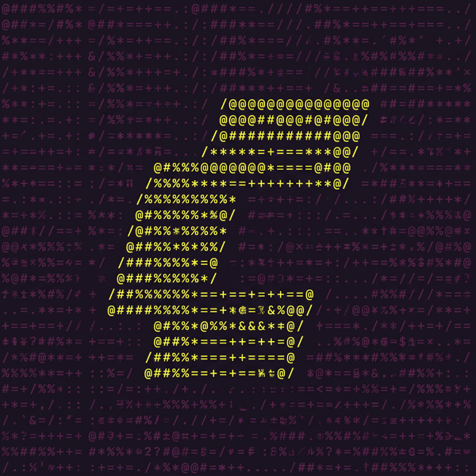

<div align="center">



<h1>Comfy Skills</h1>

</div>

Home of **Comfy skills and plugins for AI coding agents**. **`comfy-cloud`** is the Agent Skills and MCP connection that generate images, video, audio, and 3D, search models and nodes, and run ComfyUI workflows through [Comfy Cloud](https://cloud.comfy.org). **`comfy-sdk`** is guidance for building apps on the Comfy SDK and Comfy Router.

> **Contributions welcome.** We'd love your help strengthening these skills — submissions and pull requests are open, and we look forward to building this out with the community.

## Install (Claude Code) — comfy-cloud

The **`comfy-cloud`** plugin bundles the Comfy Cloud MCP connection **and** Agent Skills in one step. The same plugin is what chat, Cowork, and Claude Code install. Skills load in all three. Slash commands in `claude-code/commands/` still run by name in Cowork and Claude Code; in chat, Anthropic loads those command files as skills too.

```
/plugin marketplace add Comfy-Org/comfy-skills
/plugin install comfy-cloud@comfy-skills
```

Then run `/mcp` to sign in (OAuth). That's it — the plugin registers the hosted MCP server (`https://cloud.comfy.org/mcp`) and adds the skills.

In chat and Cowork, open Customize, then the Plugins tab (in Cowork, open the Cowork tab first). Select Add, then Add marketplace, choose Add from a repository, and enter `Comfy-Org/comfy-skills`. Open Discover, select `comfy-cloud`, and click Add. Then sign in from the plugin's Connectors tab. Plugins need a paid Claude plan, and a Team or Enterprise admin may limit which marketplaces can be added.

The connector URL is the same hosted server. Skills are namespaced under the plugin, e.g. `/comfy-cloud:generate-image`, `/comfy-cloud:search-models`, `/comfy-cloud:help`. Asking in plain language loads the matching skill.

Full per-client setup, including adding the server without the plugin, lives in the docs: **https://docs.comfy.org/cloud/mcp**

## Install (Claude Code) — comfy-sdk

Building an app on the Comfy SDK (Python `comfy-sdk`, TypeScript `@comfyorg/sdk`) and Comfy Router? The **`comfy-sdk`** plugin is guidance only (no MCP server): one skill that steers the agent on client choice, server-side credentials, discover-then-call, `run` vs `submit`, timeouts, idempotency and error buckets.

```
/plugin marketplace add Comfy-Org/comfy-skills
/plugin install comfy-sdk@comfy-skills
```

**Other agents:** the skill is one file, [`claude-code-sdk/skills/comfy-sdk/SKILL.md`](claude-code-sdk/skills/comfy-sdk/SKILL.md). Copy it into `.claude/skills/comfy-sdk/`, your Cursor rules, or `AGENTS.md`; or, with comfy-cli, run `comfy skills install --skill ./claude-code-sdk/skills/comfy-sdk`.

## Skills

Agent Skills for Comfy Cloud live in `claude-code/skills/<name>/SKILL.md`. Claude loads a skill when the request matches its description. The same names are invocable as `/comfy-cloud:<name>`.

| Skill | What it does |
|---|---|
| `generate-image` | Generate, edit, or restyle a still image |
| `generate-video` | Generate, edit, or extend a video |
| `generate-audio` | Generate speech, music, or sound effects |
| `clone-voice` | Clone a voice from a reference recording and speak with it |
| `generate-3d` | Generate a 3D model |
| `remove-background` | Remove or replace an image background |
| `upscale-image` | Upscale an image |
| `search-models` | Search available models |
| `search-nodes` | Search available nodes |
| `search-templates` | Search workflow templates |
| `consistent-characters` | Keep a character matching across shots, using the server's live technique |
| `help` | Show what Comfy Cloud can do |

`combine-people` stays a slash command only (`claude-code/commands/combine-people.md`). The live composite recipe is the MCP server's technique tool, fed by `skills/technique-combine-people.md`. The plugin does not ship that recipe a second time as a skill. The same is true of the other technique recipes under `skills/technique-*.md` (consistent characters is the one short skill that points at the live technique; the recipes themselves stay on the server).

Slash commands for the other workflows remain next to the skills for explicit invocation in Claude Code and Cowork. Their bodies are the longer procedures. The skills add the cross-surface rules (OAuth, no API key in chat, discover the live catalog) and do not replace the MCP server's own prompts.

## Repo layout

- **`claude-code/`** — the `comfy-cloud` plugin: `skills/` (Agent Skills), `commands/` (slash commands for Cowork and Claude Code), `.mcp.json` (the hosted connector), and `.claude-plugin/plugin.json` (metadata). **Edit the Comfy Cloud plugin here.** There is no `techniques/` directory on `main`.
- **`claude-code-sdk/`** — the `comfy-sdk` plugin: a single `skills/comfy-sdk/SKILL.md` plus `.claude-plugin/plugin.json` (metadata only, no MCP server). Keep it one file: comfy-cli and the copy-it-raw targets read only `SKILL.md`. CI (`.github/workflows/sdk-skill-smoke.yml`) checks its code blocks against the latest published SDKs.
- **`.claude-plugin/marketplace.json`** — the marketplace manifest so `/plugin marketplace add Comfy-Org/comfy-skills` resolves both plugins.
- **`skills/`** — *legacy* flat files for the deprecated `comfy-cloud-mcp` curl installer. Frozen. The Comfy Cloud MCP server's `refresh-skills` job mirrors `skills/*.md` into production prompts. Do not add Agent Skills here and do not rewrite these files to change the plugin.

`comfy-cli`'s own agent skills (`comfy`, `comfy-debug`, `comfy-relay`, `comfy-director`, `comfy-build`, ...) no longer live here — they ship bundled inside [comfy-cli](https://github.com/Comfy-Org/comfy-cli) itself (`comfy_cli/skills/`), versioned with each CLI release, and are installed the same way as ever via `comfy skills install`.

## Authoring rule: steer the approach, defer the specifics

A skill or command installed on a user's machine is **frozen at install time**. So it must never hard-code facts that change -- which templates exist, which model names are live, which nodes are available. Those rot, and a user who installed in spring is then following guidance written in winter.

Write skills and commands in two layers:

1. **Stable steering** (safe to freeze): the approach. For example, "look for a template first, clone it, swap the input, then submit; prefer structured discovery over guessing."
2. **Live specifics** (never freeze): tell the agent to *discover* current options at run time via the tools, rather than listing them inline. For example, use `search_templates` with the `tag` filter, or `search_nodes` with its typed `output_type` / `category` params, instead of pasting today's template names or node lists into the command.

If you find yourself writing a literal model name, template name, or node id into a command, stop and point the agent at the tool that returns the current set instead. That keeps the command correct as the catalog moves, and it keeps the agent from going off on a tangent before it engages the right tool.

- **Build steps must leave the user a canvas-readable artifact: titled nodes + a saved workflow link.** Any step that has the agent build a workflow JSON tells it to give every node a `_meta.title` naming its role, and, when the user asked for a workflow rather than just an output, to `save_workflow` it with `overwrite: false` (a new name on collision, never replacing the user's existing workflow) and return the `get_workflow_canvas_url` link for the `workflow_id` the save returned (looked up with `list_saved_workflows` if the result omits it) — never by filename, which publishes a public share snapshot.

## Contributing

Skills are `claude-code/skills/<name>/SKILL.md` with `name` and `description` frontmatter. The description is the trigger: the situations a user would be in. Commands are plain markdown with a short YAML frontmatter `description` under `claude-code/commands/`. The `comfy-sdk` skill stays the single file `claude-code-sdk/skills/comfy-sdk/SKILL.md`. Keep them thin per the rule above, and open a PR. Run `claude plugin validate ./claude-code` and `claude plugin validate ./claude-code-sdk` before pushing. Keep prose clear and free of emoji.

## Status

`comfy-cloud` is the Comfy Cloud plugin (hosted MCP connector + Agent Skills, with slash commands kept for Cowork and Claude Code). `comfy-sdk` is the SDK and Router guidance plugin (no MCP server). The legacy `skills/` flat layout remains the MCP prompt snapshot and the deprecated `comfy-cloud-mcp` installer source. Cursor / Codex support can be added later as sibling folders.
